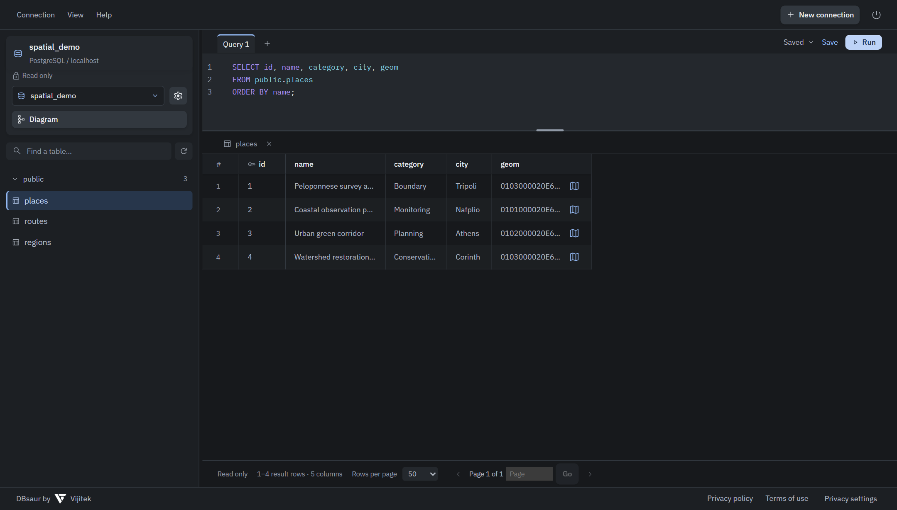
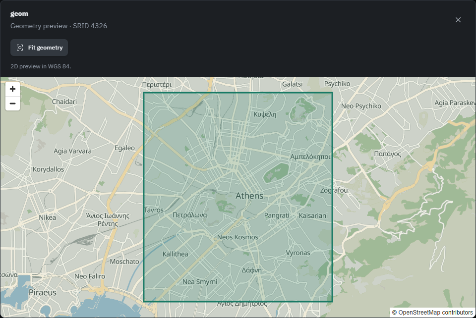
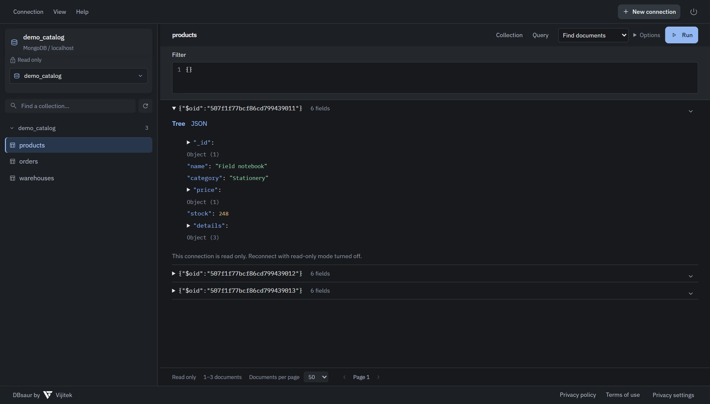

# DBsaur

DBsaur is a desktop app for browsing databases, running queries, and reviewing changes before saving them. It supports PostgreSQL, MySQL, MariaDB, SQL Server, SQLite, and MongoDB.

**[Download DBsaur](https://github.com/stelios-vitzi/dbsaur/releases)** · [User guide](docs/user-guide.md) · [Contributing](CONTRIBUTING.md)



## Install and try it

Choose the package for your platform from [GitHub Releases](https://github.com/stelios-vitzi/dbsaur/releases). The installer includes the desktop app and its embedded API.

| Platform                           | Package          | How to install                                  |
| ---------------------------------- | ---------------- | ----------------------------------------------- |
| Windows x64                        | Setup `.exe`     | Run setup and choose current user or all users. |
| macOS 11+, Intel and Apple Silicon | Universal `.dmg` | Drag DBsaur into Applications.                  |
| Linux x64, Debian or Ubuntu        | `.deb`           | Run `sudo apt install ./<filename>.deb`.        |
| Linux x64, Fedora                  | `.rpm`           | Run `sudo dnf install ./<filename>.rpm`.        |
| Linux x64, portable                | `.AppImage`      | Make the file executable and run it.            |

Linux packages require WebKitGTK 4.1. See the [desktop update guide](docs/desktop-updates.md)
for update support by package type and operating-system signing details.

Open **Sample workspace** to browse read-only example data without a database connection.
To work with your own data, choose **Add database** and select your provider.

## What you can do

- Explore schemas, tables, keys, and relationships. Sort and page through records, inspect cell values, and export the current page.
- Run read-only SQL in independent tabs with completion and locally saved queries. Browse and edit MongoDB documents as JSON, and run read-only aggregation queries. [MongoDB guide](docs/user-guide.md#mongodb)
- Review record and schema changes before saving them. Supported changes depend on the provider. [Database provider guide](docs/user-guide.md#database-providers)
- Open interactive previews of PostGIS geometry and geography directly from result cells. [PostGIS map guide](docs/user-guide.md#postgis-map-previews)
- Reconnect using profiles and credentials stored in an encrypted local vault. [Vault backup and recovery](docs/user-guide.md#vault-backup-and-recovery)

<details>
<summary>See the PostGIS map and MongoDB document browser</summary>




</details>

DBsaur is in early development. Use a database account with read-only permissions for browsing.
Saving changes can permanently modify data. See the [security policy](SECURITY.md).

## Develop from source

Use Node.js 26.13+ and Rust 1.99.1 with rustfmt and Clippy. Install the
[Tauri prerequisites for your platform](https://v2.tauri.app/start/prerequisites/),
then run these commands from the repository root.

```sh
npm --prefix frontend ci
cargo install tauri-cli --locked --version 2.12.4
cargo xtask dev
```

Rerun `cargo xtask dev` after frontend changes. It builds the static Vue interface
and opens the Tauri window with the embedded Rust API.

| Command               | Purpose                                                   |
| --------------------- | --------------------------------------------------------- |
| `cargo xtask check`   | Generate frontend assets and check the desktop Rust code. |
| `cargo xtask build`   | Build native packages for the current platform.           |
| `cargo xtask install` | Build and install locally or open Windows setup.          |

Native packages are written under `dist/release/bundle/`, or under
`dist/<target>/release/bundle/` when building for an explicit target. Run
`cargo xtask --help` for local installer options.

## Tests and releases

```sh
npm run typecheck
npm run lint
npm test
npm run test:packaging
npm run test:desktop
cargo install cargo-audit --locked --version 0.23.0
npm run audit
```

Live database integration tests require an explicitly configured disposable database.
See the [integration test guide](docs/user-guide.md#integration-tests).

Pushing a version tag such as `v0.3.2` runs the [desktop release workflow](.github/workflows/desktop-release.yml).
Publishing requires passing checks and native builds on Windows, Linux, and macOS.
High or critical npm advisories, any RustSec vulnerability across the three Cargo
lockfiles, or an audit error block publication. [Release signing setup](docs/desktop-updates.md#maintainer-setup)

The approved source version is tracked separately from the installer version generated
by CI as `<source-major>.<source-minor>.<run-number>`. See the [project instructions](AGENTS.md#version-changes)
for version changes.

## License

[MIT](LICENSE) · [Third-party notices](THIRD_PARTY_NOTICES.md)
